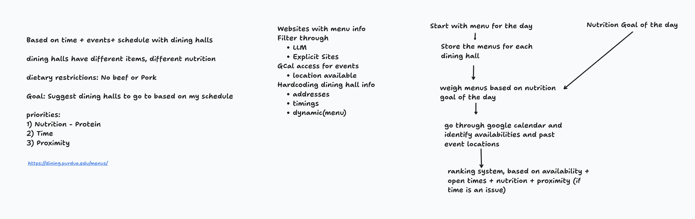

# Dining Hall Nutrition Planner

A Python command-line tool that tells a Purdue student **which dining hall to eat at, and
what to put on the plate**. It ranks each day's options by how well they meet a daily
nutrition goal, whether they fit the free time in your calendar, and how close they are to
your next class.

It pulls live menus and per-item nutrition data from Purdue's dining API, reads free time
from a private iCal feed or the Google Calendar API, and combines everything into one
ranked list.

## Features

- **Live menu data**: fetches dining hall locations, daily menus and nutrition facts from
  the Purdue Dining API. Item lookups run concurrently and are cached on disk.
- **Plate builder**: for each hall and meal, a greedy heuristic builds the best plate. It
  starts with the most protein-efficient main dish, then adds items by protein per calorie
  while staying under the calorie limit.
- **Weighted scoring**: priorities are nutrition > time > proximity. Within the nutrition
  score: maximize protein > stay under calories > minimize fat.
- **Calendar-aware**: turns calendar events into free-time windows and drops meals that are
  already over when you run it for today.
- **Proximity**: scores each hall by its distance from the buildings of the events before
  and after a free window.
- **Dietary filter**: whole-word keyword matching on item names and ingredients
  (e.g. no beef or pork), so "ham" doesn't flag "graham cracker".
- **Tested**: a `pytest` suite covering the scorer, recommendation engine, dietary filter,
  calendar parsing and API client.

## Tech Stack

- **Language:** Python 3
- **Libraries:** `requests`, `icalendar`, `recurring-ical-events`, `python-dateutil`,
  Google API client (`google-api-python-client`, `google-auth-oauthlib`)
- **Testing:** `pytest`
- **Data sources:** Purdue Dining API (`api.hfs.purdue.edu/menus/v2`), iCal / Google Calendar

## How It Works

```
Purdue Dining API ──> menus + nutrition ──> NutritionScorer ──┐
                                            (best plate)       │
                                                                ├──> RecommendationEngine ──> ranked picks
Calendar (iCal / Google) ──> free-time windows ─────────────────┘   (nutrition, time, proximity)
```

Each (dining hall, meal) that overlaps a free window gets a combined score:

| Component  | Weight | How it's measured                                           |
|------------|--------|-------------------------------------------------------------|
| Nutrition  | 0.60   | Protein vs. per-meal target, calorie limit, fat penalty      |
| Time       | 0.25   | Minutes of overlap with your free window (30 min = full score) |
| Proximity  | 0.15   | Distance to the nearest calendar event's building           |

If an event's location isn't in the building map, the proximity weight is spread across the
other two scores instead of guessing a distance. All weights live in
[`dining_planner/config.py`](dining_planner/config.py).

The original design sketch for the project:



## Project Structure

```
dining_planner/
├── main.py                    # CLI entry point
├── purdue_dining_client.py    # Purdue Dining API client (menus, nutrition, caching)
├── recommendation_engine.py   # Combines nutrition, time and proximity into a ranking
├── nutrition_scorer.py        # Builds the best plate and scores it against the goal
├── nutrition_goal.py          # Daily goal, split into per-meal targets
├── dietary_filter.py          # Keyword-based dietary restrictions
├── calendar_events.py         # Calendar events -> free-time windows
├── ical_calendar_client.py    # Private iCal feed reader
├── google_calendar_client.py  # Google Calendar API (OAuth) reader
├── dining_hall.py, menu.py, menu_lookup.py, models.py
└── config.py                  # Scoring weights, building coordinates, paths
tests/                         # pytest suite
```

## Getting Started

### 1. Install

```bash
git clone https://github.com/IsheetaChadha/dining-hall-nutrition-app.git
cd dining-hall-nutrition-app
python3 -m venv venv
source venv/bin/activate
pip install -r requirements.txt
```

### 2. Try it without a calendar

You can pass free-time windows by hand:

```bash
python -m dining_planner.main --window 11:30-13:00 --window 17:30-19:00
```

Other options:

```bash
python -m dining_planner.main --date 2026-09-08 --protein 120 --calories 1800 --top 3
python -m dining_planner.main --help
```

### 3. (Optional) Connect a calendar

**Private iCal link (simplest, no Google Cloud setup).** In Google Calendar on the web, go to
Settings → your calendar → *Integrate calendar* → copy **Secret address in iCal format**
(Outlook and Apple publish links work too), then save it:

```bash
mkdir -p credentials
echo 'https://calendar.google.com/calendar/ical/.../basic.ics' > credentials/calendar_url.txt
```

That file is gitignored. Treat the URL like a password. When it exists, it's used instead
of the Google Calendar API.

**Google Calendar API (OAuth).**

1. Create a Google Cloud project and enable the **Google Calendar API**.
2. Create an OAuth client ID of type **Desktop app**, download the JSON, and save it as
   `credentials/client_secret.json` (gitignored).
3. The first run opens a browser for consent and caches a token at
   `credentials/token.json` (also gitignored).

### 4. (Optional) Add your campus buildings

Edit `BUILDING_COORDS` in `dining_planner/config.py` with the buildings you have classes in,
keyed by building code (`"WALC"` matches an event location of `WALC 2121`) → `(lat, lon)`.
Events in buildings that aren't listed just skip proximity scoring.

## Running Tests

```bash
pytest
```

## Possible Improvements

- Replace the greedy plate builder with an exact knapsack-style optimizer.
- Support multiple dietary profiles (vegetarian, allergens) from the API's allergen data.
- A small web front end for picking a goal and viewing recommendations.
